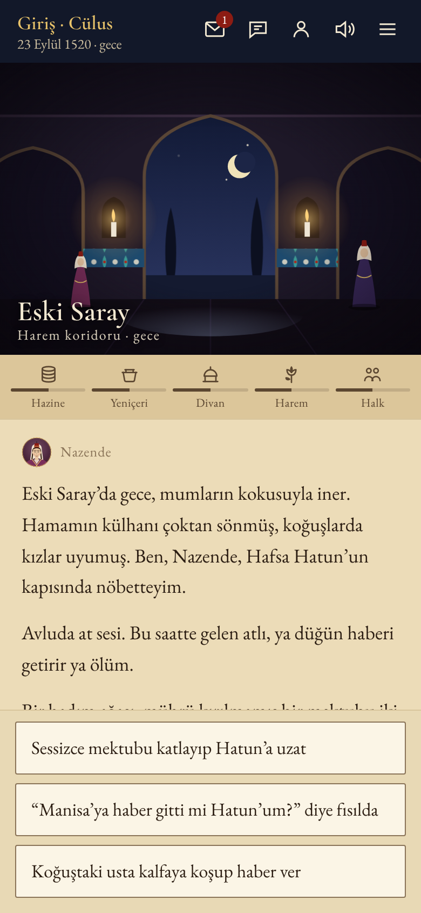
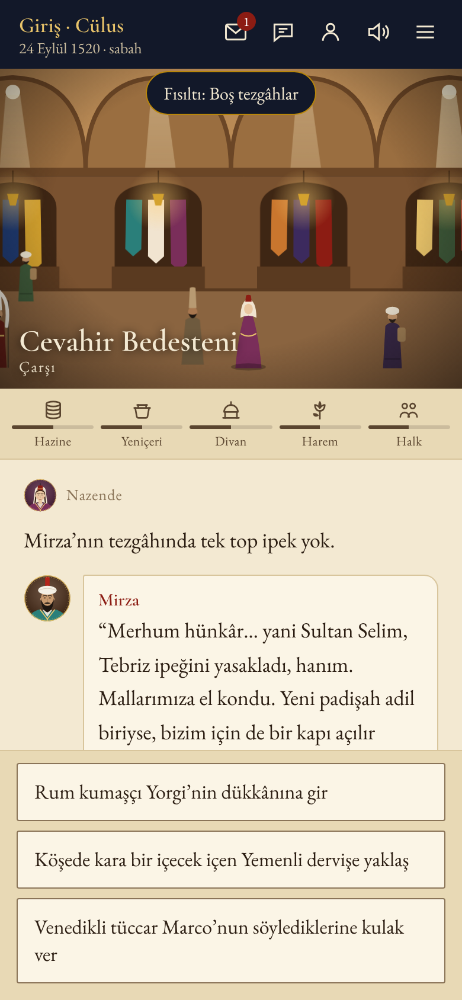
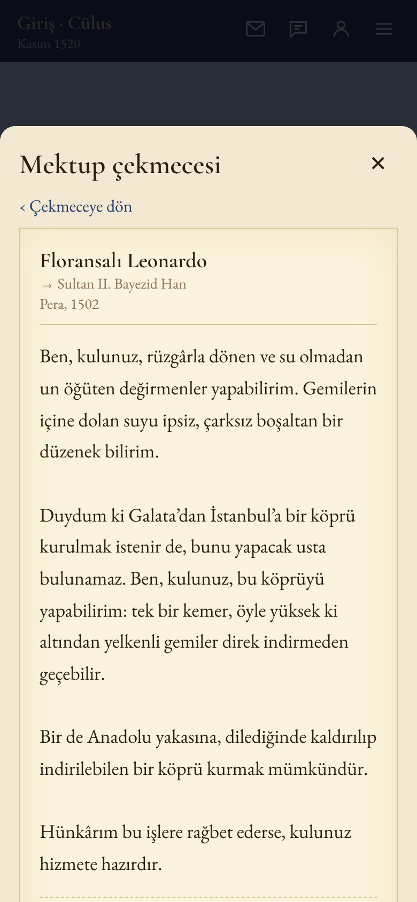
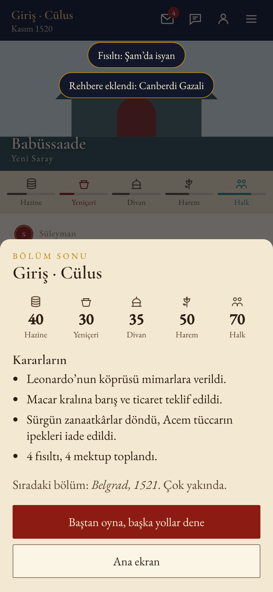
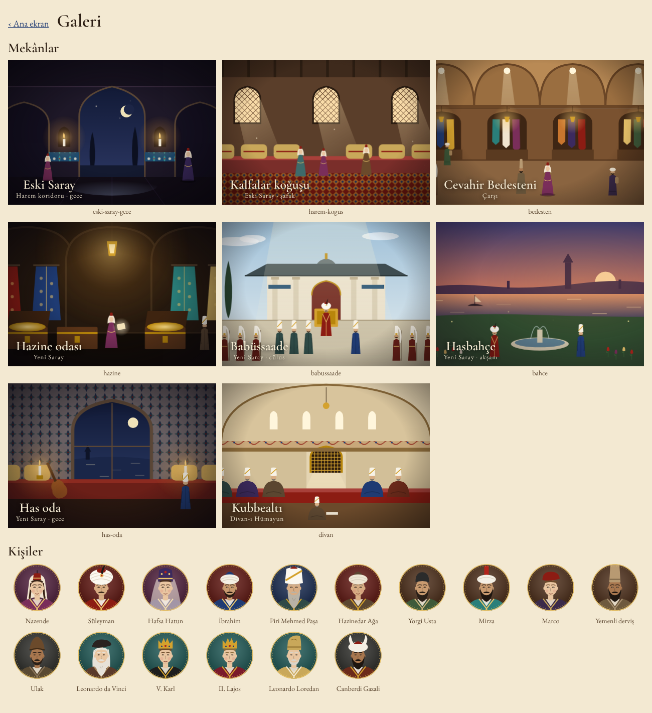

# Konstantiniyye · Kanuni'nin Yüzyılı

Kanuni Sultan Süleyman döneminde (1520–1566) geçen, karar odaklı bir anlatı oyunu. iOS ve Android için geliştiriliyor.

Oyuncu, sarayda çalışan ve haftada bir çarşıya çıkan **Nazende Kalfa** ile oyuna girer. Büyük anlarda bakış açısı Süleyman'a, İbrahim'e, Hürrem'e ve Mustafa'ya geçer. Kalfanın çarşıda ve kapı arkalarında topladığı **fısıltılar**, sonraki bölümlerde büyük karakterlerin önüne yeni seçenekler çıkarır. **Mektuplar** mühürlenir, yolda gecikir, okunur ya da sahtesi yazılır.

> Tarihî olaylardan esinlenmiş bir kurgudur. Gerçek kişiler tarihî kaynaklara dayanır. Nazende, çarşı esnafı gibi bazı karakterler oyun için yaratılmıştır. Herhangi bir dizi veya yapımla bağlantısı yoktur.

<p>
  
  
  
  
</p>

## Görsel ve ses

- **8 mekân çizimi** (`src/app/ui/scenes/`): Eski Saray harem koridoru, kalfalar koğuşu, Cevahir Bedesteni, hazine odası, Babüssaade'de cülus, Hasbahçe, has oda, Kubbealtı. Hepsi vektör, telefonda keskin.
- **Işık:** titreyen mumlar, kafesten süzülen huzmeler, toz zerreleri, altın pırıltısı, Haliç'te ışıltı, ateş böcekleri. Gece sahnelerinde sayfa da mum ışığı tonuna döner.
- **İnsanlar:** sahnelerde vezirler, yeniçeriler, tüccarlar, dervişler, kadınlar. Çarşıda kalabalık yürür. Karakterler minyatür üslubunda portrelerle konuşur; başlıklarından tanınırlar (sorguçlu kavuk, kallavi, Kızılbaş tacı, Venedik beresi, Doç'un boynuzlu başlığı…).
- **Ses** (`src/app/game/audio.service.ts`): tamamen kodla üretilir, dosya gerekmez. Mekâna göre cırcır böcekleri, rüzgâr, mum çıtırtısı, çarşı uğultusu, bakırcı çekici, sikke şıngırtısı, fıskiye, kuşlar, cülusta mehter davulu. Sakin sahnelerde **Hicaz makamında doğaçlama ney**. Mühür kırılınca ve karar verilince ses efekti. Üst bardan kapatılabilir.
- **Galeri:** `/galeri` adresinde tüm mekânlar ve portreler. Çizimleri gözden geçirmek için.



### Canlandırılmış karakterler (ilk örnek: İbrahim)

Şeffaf arka planlı tek bir resim, WebGL ile "canlı portreye" dönüştürülür (`src/app/ui/actor-stage.ts`):
- İlk konuştuğu sahnede karşıdan **yürüyerek gelir** (adım adım sekme, ayak sesleri).
- **Nefes alır**, **göz kırpar**, başını hafifçe oynatır.
- **Konuşurken** çenesi hece hece açılıp kapanır, başı onaylar gibi oynar, sarkan eli küçük bir jest yapar.
- Mekânın ışığını alır (gün batımında sıcak, mum ışığında turuncu kenar ışığı); arka plan bulanıklaşır.
- Oyuncu görünmez: sahne senin gözünden. Yatay ekranda solda sahne, sağda yazılar.

Yeni karakter eklemek: şeffaf PNG'yi `public/art/actors/<id>.webp` olarak koy, `src/app/data/actors.ts` içine göz, ağız, çene, boyun ve dirsek koordinatlarını gir. O karakter konuştuğunda sahneye kendiliğinden çıkar. Ink'te `# actor: <id>` ile konuşmadan da sahneye çıkarılabilir, `# actor: none` ile indirilir.

### Gerçek çizim eklemek

Vektörler yer tutucu değil, kalıcı bir üslup. Ama elle çizilmiş ya da başka bir yolla üretilmiş görseller gelirse:
1. `public/art/scenes/<sahne-id>.webp` (20:11, en az 1600×880) veya `public/art/portraits/<karakter-id>.webp` (kare, en az 512) olarak koy.
2. `src/app/data/art-manifest.ts` içindeki listeye id'yi ekle.

Oyun o mekân ya da kişi için otomatik olarak resmi gösterir. Oyuncu yüzleri, dizi görüntüleri ve telifli tablolar kullanılmamalı.

## Şu an oynanabilen: Giriş · Cülus (Eylül–Kasım 1520)

- Selim'in ölüm haberi gece Eski Saray'a ulaşır. Hafsa Hatun sır tutulmasını ister.
- Nazende Bedesten'e iner. Öğle ezanına kadar dört kişiden yalnızca ikisini dinleyebilir: yeniçeri bahşişi, Acem ipek yasağı, Yemenli dervişin kahvesi, Habsburg Karl'ın taç giymesi.
- Yeni Saray'ın hazinesinde Bayezid Han'ın sandığından **Leonardo da Vinci'nin 1502 tarihli köprü mektubu** çıkar.
- Süleyman'ın cülusu: bahşiş, sürgün zanaatkârlar, ipek yasağı, Piri Paşa mı İbrahim mi?
- İbrahim mektubu okursa Haliç köprüsü projesi açılır. Bu, alternatif tarihin kapısıdır.
- Venedik Doçu'ndan tebrik, Macar kralı II. Lajos'a haraç ya da barış naması.
- Şam'da Canberdi Gazali isyanı (bölüm sonu).

## Yol haritası

| Bölüm | Bakış açısı | Durum |
|---|---|---|
| Giriş · Cülus 1520 | Nazende → Süleyman | ✅ oynanabilir |
| Belgrad ve Rodos 1521–22 | Süleyman + İbrahim | ⏳ |
| Mohaç 1526 | Süleyman | ⏳ |
| Viyana 1529 | İbrahim | ⏳ |
| Harem 1530'lar | Hürrem | ⏳ |
| 1536 | İbrahim (Parga'ya dönüş seçeneği) | ⏳ |
| Şehzadeler 1553 | Mustafa + Süleyman | ⏳ |

**Ana sonlar:**
- **Kızıl Elma:** Viyana düşer.
- **Adil Veliaht:** Mustafa yaşar.
- **Parga'ya Dönüş:** İbrahim gücü bırakır.

**Dönemin yenilikleri:** Piri Reis'in haritaları, Matrakçı Nasuh, Mimar Sinan, Süleymaniye, ilk kahvehane (1554–55, Tahtakale), Kırkçeşme su yolu, Avrupa'dan gelen mekanik saatler, matbaa tartışması.

## Teknoloji

- **Angular 22** (standalone, signals). Arayüzün tamamı burada.
- **Capacitor 8**: aynı kod iOS ve Android uygulaması olarak paketlenir.
- **[Ink](https://www.inklestudios.com/ink/) / inkjs**: dallanan hikâye `story/*.ink` dosyalarında yazılır, derleme sırasında JSON'a çevrilir.
- Kayıt cihazda tutulur (Capacitor Preferences). Her karardan sonra otomatik kaydedilir. Şimdilik backend yok.

```
story/giris.ink              hikâye (Ink dili)
scripts/compile-ink.mjs      .ink → public/story/*.json
scripts/playtest.mjs         her yolu rastgele oynayıp hata arar
src/app/game/story.service   ink motoru ↔ arayüz köprüsü (signals)
src/app/data/                karakterler, mektuplar, fısıltılar, sahneler
src/app/screens/             başlık ekranı, oyun ekranı
src/app/ui/                  portre, sahne bandı, gösterge ikonları
```

## Çalıştırma

Gerekenler: **Node.js 22.22.3 veya üstü** (Angular 22 bunu istiyor). nvm kullanıyorsan `nvm use` yeterli.

```bash
npm install
npm start            # http://localhost:4200 (ink otomatik derlenir)
npm run playtest     # hikâyeyi 500 kez rastgele oynar, hata ve çıkmaz sokak arar
```

Tarayıcıda telefon görünümü için DevTools'ta cihaz modunu (iPhone 14 vb.) aç.

## iOS'ta çalıştırma (Mac)

Gerekenler: Xcode, CocoaPods (`brew install cocoapods`).

```bash
npx cap add ios      # sadece ilk sefer, ios/ klasörünü oluşturur
npm run ios          # derler, senkronlar, Xcode'u açar → simülatörde ▶
```

Android için: `npx cap add android` ve ardından `npm run android` (Android Studio gerekir).

### App Store'a çıkış için kalanlar

- [ ] Apple Developer Program üyeliği
- [ ] Uygulama ikonu ve açılış ekranı (`@capacitor/assets` ile üretilecek)
- [ ] Gerçek karakter portreleri ve sahne çizimleri (şu an vektör yer tutucular)
- [ ] Müzik ve ortam sesleri (ney, ud, çeşme, kapı)
- [ ] En az 2–3 bölüm içerik
- [ ] Gizlilik politikası sayfası (veri toplanmıyor, ama App Store yine de ister)
- [ ] TestFlight ile beta

## Hikâye yazmak

Ink sözdizimi: [Writing with Ink](https://github.com/inkle/ink/blob/master/Documentation/WritingWithInk.md). Oyunun kullandığı etiketler:

| Etiket | Anlamı |
|---|---|
| `# chapter: …` | bölüm başlığı |
| `# date: …` | sahne tarihi |
| `# scene: <id>` | arka plan (`src/app/data/scenes.ts`). Sahne değişince sayfa kesilir. |
| `# pov: <karakter-id>` | bakış açısı değişimi |
| `# speaker: <karakter-id>` | konuşan kişi (portreli balon) |
| `# thought` | iç ses |
| `# end_chapter` | bölüm sonu ekranı |

Değişkenler: `hazine`, `yeniceri`, `divan`, `harem`, `halk` (0–100); `f_*` fısıltılar; `l_*` mektuplar. Yeni bir fısıltı ya da mektup eklerken hem `.ink` dosyasına `VAR` olarak, hem de `src/app/data/` altındaki ilgili dosyaya ekle.

Tarihî bir olay eklerken kaynağını commit mesajına ya da ink dosyasına yorum olarak yaz.
